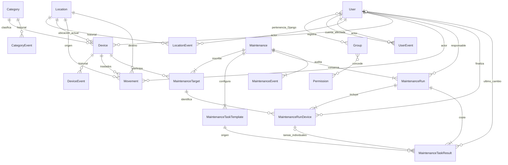

# Modelo de datos

`User` extiende AbstractUser desde la primera migración, evitando una sustitución futura
costosa. Conserva username, hash de contraseña, nombres y correo opcionales, `is_active`,
flags internos de Django y `version`. No hay DNI ni datos reales precargados. Username
es único sin distinción de mayúsculas mediante índice funcional `Lower`; el login usa
el nombre tal como se registró (autenticación nativa sensible a mayúsculas).

La relación User–Group es M:N nativa. El servicio restringe cada cuenta de negocio a un
solo rol fijo; no se duplica el rol en otra columna. Un superusuario técnico no requiere
rol de negocio. Las asignaciones directas por shell son responsabilidad del operador.

`Location`: nombre (120), código opcional (24), tipo, descripción opcional (2.000),
activo, versión y timestamps aware. Normaliza espacios periféricos y código a mayúsculas.
Nombre único sin distinción de mayúsculas; código también, salvo el vacío. Tres tipos
válidos mediante TextChoices y CHECK de PostgreSQL; nombre no vacío también mediante CHECK.

`UserEvent`: cuenta afectada, actor, fecha, acción y cambios antes/después.
`LocationEvent`: ubicación, actor y los mismos campos de auditoría. Se justifican dos
entidades para conservar claves foráneas reales y PROTECT, sin relaciones genéricas débiles.
No almacenan hashes, contraseñas, cookies ni tokens. Las fechas se presentan en Lima.

No se ofrece eliminación física. Los managers y modelos rechazan DELETE; eventos también
rechazan update/save posterior. Las referencias al actor y al objeto usan PROTECT.
Estas barreras ORM no sustituyen controles de privilegios del administrador de la BD.

Migraciones:

- `accounts/0001_initial`: User, UserEvent e índice único de username.
- `locations/0001_initial`: Location, LocationEvent, restricciones e índices únicos.
- `accounts/0002_validation_messages`: mensajes de validación en español (estado de migración).
- `locations/0002_validation_messages`: mensajes de validación en español (estado de migración).

No se borraron migraciones aplicadas. Los grupos se aprovisionan después de `migrate`
con `sync_roles`, porque los permisos de Django se crean durante `post_migrate`.
La relación Location–Device ya está implementada con PROTECT.

`Category`: nombre único sin distinción de caja, tipo de referencia, descripción,
activo y versión. La migración inicial de datos aporta seis categorías genéricas;
no contiene información institucional ni usuario ficticio como actor de configuración.

`Device`: PK entero; UUID público único para URL estable autenticada; código público
único de 11 caracteres; nombre, categoría y ubicación actual; marca/modelo y serie
opcionales; estado, observaciones, detalles técnicos libres, adquisición/puesta en
servicio opcionales, activo, versión, timestamps y creador protegido.

`Movement`: equipo, origen/destino con PROTECT, motivo, observaciones, fecha efectiva,
fecha registrada, actor y versión resultante del equipo. UNIQUE(equipo, versión)
impide duplicar un resultado de traslado; CHECK exige origen distinto de destino y
motivo no vacío. La versión también cambia por ediciones de ficha: no es un contador
de traslados. No se espera una secuencia sin huecos en Movement.device_version.

`CategoryEvent` y `DeviceEvent` reutilizan la base abstracta AuditEvent. Se añaden para
conservar auditoría con claves foráneas reales; no hay infraestructura genérica adicional.
Auditoría y eventos tienen actor/fecha y referencias protegidas. Los movimientos son
inmutables en la interfaz y en las operaciones ORM públicas provistas.

Migraciones del segundo incremento, sin alterar las previas:

- `assets/0001_initial`: cinco modelos, FKs PROTECT, índices únicos y CHECKs.
- `assets/0002_initial_categories`: seis categorías; reversión de datos no destructiva (noop).
- `assets/0003_text_length_validation`: validadores de longitud en textos también para servicios.

Tercer incremento: `assets/0004_alter_device_options` añade el permiso
`print_device_label` a Device. No crea tablas/columnas ni reescribe migraciones previas.
`sync_roles` lo asigna a Administrador y Técnico. Los QR se derivan del UUID existente
y del origen público configurado; las selecciones de impresión solo existen en memoria.

Fase 6, `maintenance/0001_initial`: siete tablas, con referencias PROTECT.

- `Maintenance`: nombre, descripción, único/periódico, fechas e intervalo consistentes,
  activo, versión, creador, timestamps y clave/firma del envío. CHECK exige fecha prevista
  sin recurrencia o fecha base/intervalo positivo sin fecha prevista.
- `MaintenanceTarget`: inscripción M:N, única por mantenimiento/equipo; activo permite
  retirar/reactivar sin borrar historia.
- `MaintenanceTaskTemplate`: nombre, orden, obligatoria/opcional, ámbito y categoría
  opcional. General no tiene categoría. Orden único entre plantillas activas. Al cambiar
  el conjunto se conservan inactivas las plantillas anteriores.
- `MaintenanceRun`: número, estado pendiente, creación y copia JSON de configuración/
  versión/fechas. Relación 1:N para historial; esta fase solo crea la primera ejecución.
- `MaintenanceRunDevice`: inscripción, ejecución, nombre/categoría copiados, vencimiento
  propio y resultado Sin finalizar. UNIQUE(ejecución, inscripción). Código inmutable y
  ubicación actual se consultan desde el dispositivo existente.
- `MaintenanceTaskResult`: copia de nombre, orden, ámbito y obligatoriedad, con enlaces
  a plantilla/ejecución. Participante obligatorio si individual, NULL si general.
  UNIQUE con NULLS NOT DISTINCT impide duplicar también las tareas generales.
- `MaintenanceEvent`: creación/cambios, ejecución opcional, actor y valores antes/después.

En fase 6, `maint_run_initial_only`, `maint_participant_initial_only` y
`maint_task_initial_only` restringían las copias a su estado inicial.

Fase 7, `maintenance/0002_execution_workflow`, sin tablas nuevas:

- Run añade seis estados, responsable nullable, primer inicio, cierre/cancelación,
  actor de cierre, motivo de cancelación, notas y versión. CHECK exige asignación en
  ASIGNADO/EN_EJECUCION, NULL en pendiente, inicio en ejecución y datos de cierre coherentes.
  En fase 7 se restringía el número a 1; fase 8 amplía la numeración.
- RunDevice añade fecha real civil, actor/timestamp de finalización, resumen, motivo de
  omisión, notas y próximo vencimiento calculado al completar. CHECK distingue Sin finalizar,
  Completado y Omitido; omitidos nunca tienen fecha real ni next_due_date.
- TaskResult añade observación opcional y último actor/timestamp de cambio. Marcar exige
  actor/fecha. Los valores previos permanecen en MaintenanceEvent.
- MaintenanceEvent sigue inmutable: TAKEN, STARTED, RESUMED, RELEASED, PROGRESS,
  DEVICE_COMPLETED, DEVICE_OMITTED, COMPLETED, PARTIALLY_COMPLETED y CANCELLED.

Las copias siguen rechazando update/bulk_update/delete y save sin campos explícitos.
Los servicios solo guardan columnas de operación admitidas por cada modelo; identidad,
equipos, tareas, due_date y configuración copiada permanecen protegidos. Django Admin
es readonly. Los permisos nuevos pertenecen a MaintenanceRun y se aprovisionan con sync_roles.

next_due_date es una copia del cálculo al completar con el intervalo entonces vigente.
No se reescribe al editar la definición. Desde fase 8 se deriva la fecha vigente desde
la fecha real individual más reciente y configuración actual, conservando esas copias.

Fase 8, `maintenance/0003_recurring_runs`: sin nuevas columnas ni tablas. Sustituye
`maint_run_first_number` por `maint_run_positive_number` (número >= 1) y añade
`maint_one_open_run`, UNIQUE(mantenimiento) condicionado a pendiente/asignado/en ejecución.
Junto con UNIQUE(mantenimiento, número) y UNIQUE(ejecución, inscripción), impide doble
apertura y duplicación de equipos, sin copiar el estado del ciclo en cada participante.

La apertura valida versión de configuración y PK del predecesor, asigna siguiente número,
copia las tareas actuales y registra RUN_CREATED con actor, equipos, fechas y motivo.
No modifica el predecesor ni incrementa la versión de configuración por una apertura.
El calendario usa subconsultas por inscripción para última fecha real, ejecución fuente
y presencia en un ciclo abierto. TargetSchedule es presentación en memoria, no tabla.
