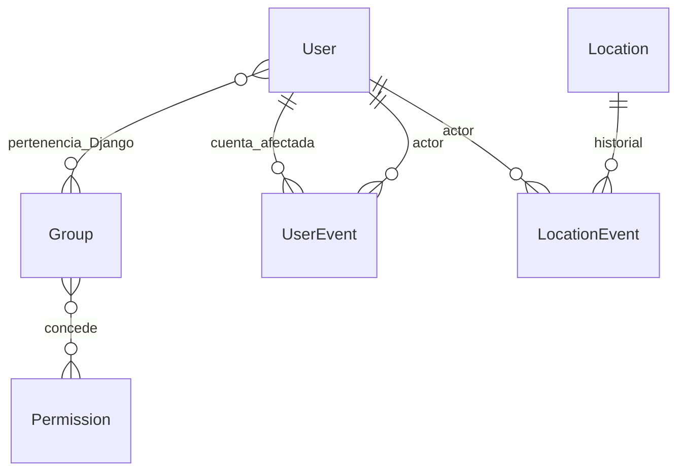

# Modelo de datos

`User` extiende AbstractUser desde la primera migración, evitando una sustitución futura
costosa. Conserva username, hash de contraseña, nombres y correo opcionales, `is_active`,
flags internos de Django y `version`. No hay DNI ni datos reales precargados. Username
es único sin distinción de mayúsculas mediante índice funcional `Lower`; el login usa
el nombre tal como se registró (autenticación nativa sensible a mayúsculas).

La relación User–Group es M:N nativa. El servicio restringe cada cuenta de negocio a un
solo rol fijo; no se duplica el rol en otra columna. Un superusuario técnico no requiere
rol de negocio. Las asignaciones directas por shell son responsabilidad del operador.

`Location`: nombre (120), código opcional (24), tipo, descripción opcional (2.000),
activo, versión y timestamps aware. Normaliza espacios periféricos y código a mayúsculas.
Nombre único sin distinción de mayúsculas; código también, salvo el vacío. Tres tipos
válidos mediante TextChoices y CHECK de PostgreSQL; nombre no vacío también mediante CHECK.

`UserEvent`: cuenta afectada, actor, fecha, acción y cambios antes/después.
`LocationEvent`: ubicación, actor y los mismos campos de auditoría. Se justifican dos
entidades para conservar claves foráneas reales y PROTECT, sin relaciones genéricas débiles.
No almacenan hashes, contraseñas, cookies ni tokens. Las fechas se presentan en Lima.

No se ofrece eliminación física. Los managers y modelos rechazan DELETE; eventos también
rechazan update/save posterior. Las referencias al actor y al objeto usan PROTECT.
Estas barreras ORM no sustituyen controles de privilegios del administrador de la BD.

Migraciones:

- `accounts/0001_initial`: User, UserEvent e índice único de username.
- `locations/0001_initial`: Location, LocationEvent, restricciones e índices únicos.
- `accounts/0002_validation_messages`: mensajes de validación en español (estado de migración).
- `locations/0002_validation_messages`: mensajes de validación en español (estado de migración).

No se borraron migraciones aplicadas. Los grupos se aprovisionan después de `migrate`
con `sync_roles`, porque los permisos de Django se crean durante `post_migrate`.
No se implementó todavía la relación Location–Device; cuando exista debe usar PROTECT.
